# Static Website on AWS using S3 and CloudFront

A static website hosted in a **private Amazon S3 bucket** and delivered globally through **Amazon CloudFront** over HTTPS. This was my first hands-on AWS cloud project.

**Live site:** https://d1hm8uww8za23b.cloudfront.net
*(The distribution may be disabled later to avoid costs.)*

## Architecture

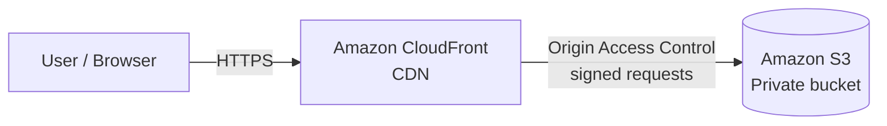

1. A visitor opens the CloudFront URL.
2. CloudFront serves the page from the nearest edge location, or fetches it from S3 if it is not cached yet.
3. The S3 bucket stays **private**. Only this CloudFront distribution is allowed to read from it.

## AWS Services Used

| Service | Purpose |
|---|---|
| **Amazon S3** | Stores the website files (`index.html`) |
| **Amazon CloudFront** | CDN that delivers the site quickly and over HTTPS |
| **Origin Access Control (OAC)** | Lets CloudFront securely read the private bucket |
| **S3 Bucket Policy** | Allows only my CloudFront distribution to read objects |
| **AWS Billing (Budgets)** | Budget alert to keep costs under control |

## What I Built

- Created an S3 bucket (`pawan-cloud-site-2026`) with **Block all public access turned on**.
- Uploaded `index.html` to the root of the bucket.
- Created a CloudFront distribution with the S3 bucket as its origin.
- Enabled **Origin Access Control** so CloudFront can read the private bucket.
- Applied the bucket policy that grants access only to the distribution.
- Set the **default root object** to `index.html`.
- Set the viewer protocol policy to **redirect HTTP to HTTPS**.
- Used the CloudFront default cache settings for S3 content.
- Tested the site using the `cloudfront.net` domain.

## Setup Steps

1. **Create the bucket:** In S3, create a bucket with a globally unique name and keep all public access blocked.
2. **Upload the site:** Upload `index.html` to the bucket root (not inside a folder).
3. **Create the distribution:** In CloudFront, choose **Create distribution**, select the S3 bucket as the origin, and enable private bucket access with OAC.
4. **Add the bucket policy:** Paste the policy generated for the distribution into the bucket's **Permissions → Bucket policy**.
5. **Set the default root object:** In the distribution settings, set it to `index.html`.
6. **Test:** Wait for the distribution to finish deploying, then open the `cloudfront.net` domain in a browser.

## Security Decisions

- **Private bucket:** The bucket is not public, so files cannot be reached directly through S3.
- **Origin Access Control:** CloudFront signs its requests to S3, and the bucket policy accepts only requests from this distribution.
- **HTTPS only:** HTTP requests are redirected to HTTPS so traffic is encrypted.

## Challenges and What I Learned

- **Account verification error:** CloudFront blocked distribution creation with a message that the account must be verified. I fixed it by completing payment method verification in Billing and contacting AWS Support as the error message instructed.
  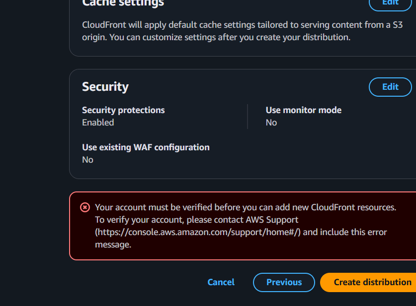
- **Bucket policy and 403 errors:** I learned that CloudFront gets a 403 error if the bucket policy is missing or the file is not in the bucket root.
- **Caching:** CloudFront caches files, so updates may need an **invalidation** (`/*`) before they appear.
- **Cost control:** I set a budget alert and chose pay-as-you-go billing for a low-traffic learning project.

## Screenshots

### Live website
Served through CloudFront.

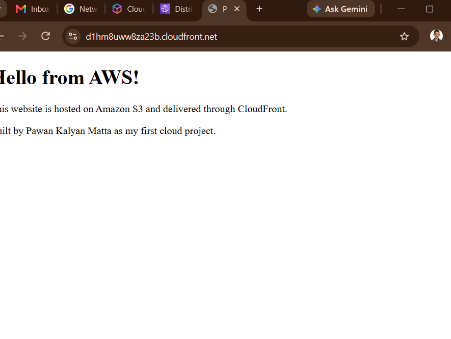

### S3 bucket (private)
Block all public access is turned **On**, so the files cannot be reached directly through S3.

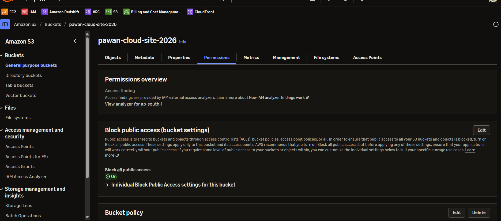

The bucket policy allows only the CloudFront service principal, and only for my specific distribution, to read objects.

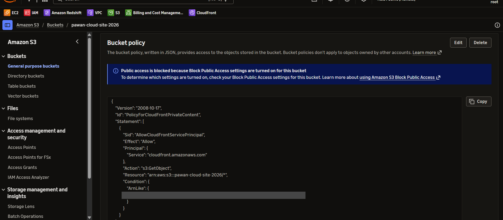

`index.html` is stored at the root of the bucket.

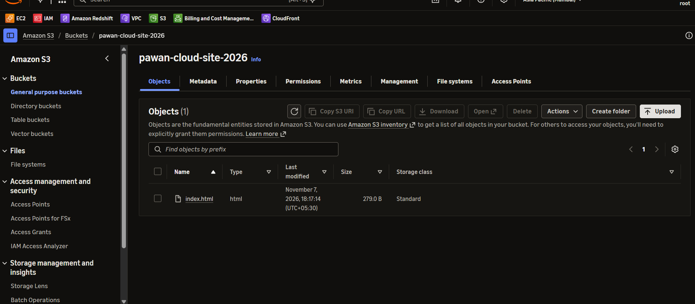

### CloudFront distribution
Distribution list, showing the distribution as enabled.

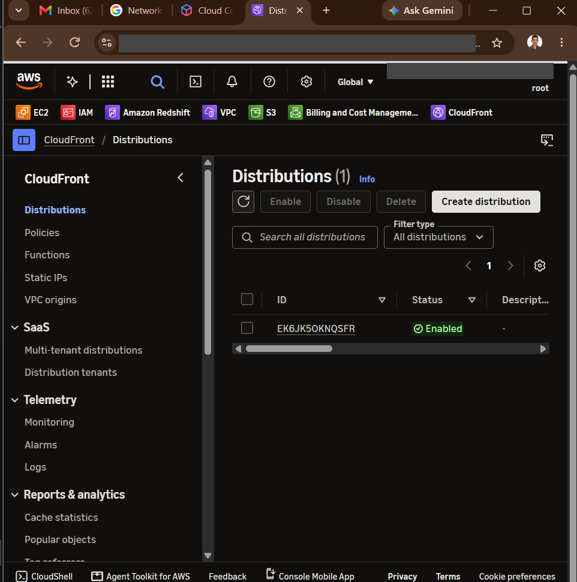

General settings, with the default root object set to `index.html`.

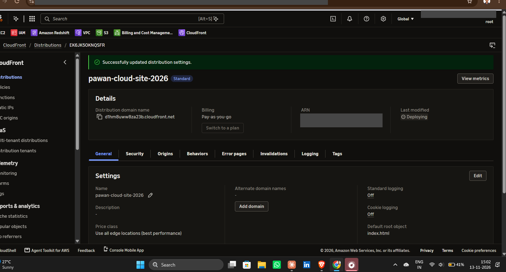

Distribution deployed successfully.

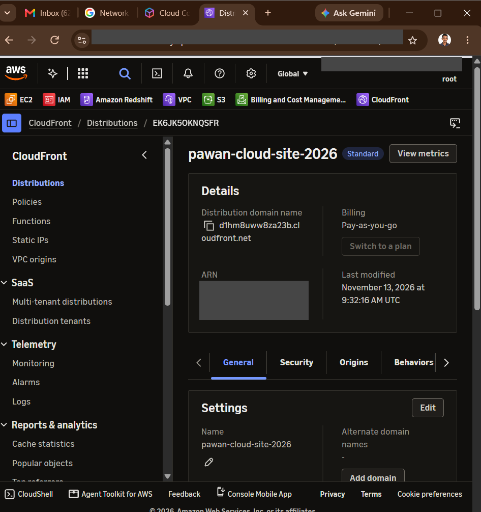

The S3 bucket as the origin, with Origin Access Control attached.

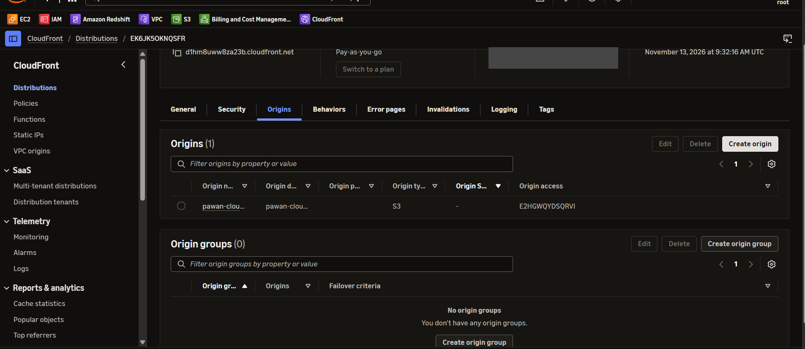

Default behavior, which redirects HTTP to HTTPS and uses a managed cache policy.

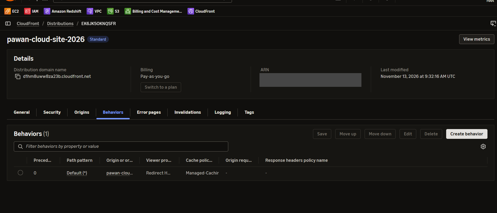

### Cost control
Budgets set up in AWS Billing to avoid surprise charges while learning.

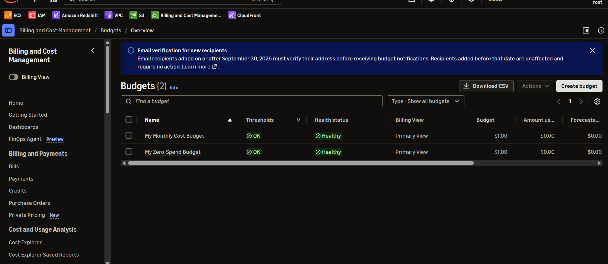

## Possible Improvements

- Add a custom domain with Route 53 and an ACM certificate.
- Automate the deployment with Terraform (Infrastructure as Code).
- Add a CI/CD pipeline with GitHub Actions to upload changes and invalidate the cache.

## Author

**Pawan Kalyan Matta**
LinkedIn: https://www.linkedin.com/in/pawan-kalyan-matta
